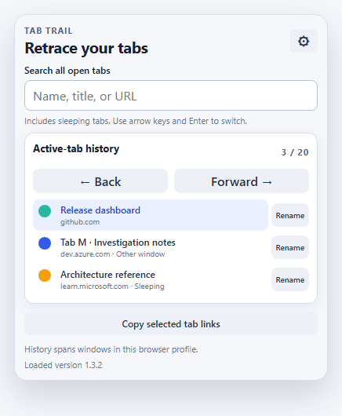

<div align="center">
  
  <h1>Tab Trail</h1>
  <p>
    Rename browser tabs and retrace the tabs you actually visited across windows, not merely the
    tabs sitting next to each other.
  </p>
  <p>
    <strong>Native Manifest V3 · Chrome + Edge · No dependencies · No analytics</strong>
  </p>
</div>

## Why Tab Trail?

Browser tab order and browsing order are different things.

Imagine tab **M** is open, five unrelated tabs sit after it, and tab **N** is at the far end. You
work in **M**, jump to **N**, and then need to return. Normal tab shortcuts move through every tab
between them. Tab Trail remembers the path you took:

```text
Visited: M → N

Alt+Shift+Left   → M
Alt+Shift+Right  → N
```

Each browser profile keeps one least-recently-used trail across all its browser windows.
The default limit is 20 tabs; Settings offers 20, 50, 100, 150, or 200 tabs.
Profiles remain isolated automatically because Chromium gives every profile separate extension
storage.

## Quick walkthrough

1. Open several tabs, including two that are far apart in the tab strip.
2. Work in the first tab, then select the second tab.
3. Press `Alt+Shift+Left` to return directly to the first tab.
4. Press `Alt+Shift+Right` to move forward to the second tab again.
5. Open the popup to see your current trail or jump directly to another recent entry.
6. Press `Alt+R` to open the focused rename experience for the current tab.
7. Press `Ctrl+Shift+Q` to open the popup with search focused. Type a name, title, or URL,
   then press Enter to switch to the first result, or use the arrow keys to select another result.

Tab Trail follows your activation path. It does not cycle through every tab positioned between the
two tabs, and it can focus a tab in another browser window.

## The popup

<div align="center">
  
</div>

The popup shows the current history position, marks sleeping tabs and entries from other windows,
and lets you navigate backward or forward. Search includes **all open tabs in the current profile**,
not only those retained in the trail. Clear the search to return to the trail. Escape clears a search;
press Escape again to dismiss the popup.

Each row has a **Rename** button that opens the rename window for that specific tab without first
switching to it. `Alt+R` still renames the active tab. The gear button opens Settings and shortcuts.
The **Copy selected tab links** button copies the tabs selected in the browser's tab strip,
not the search results.

## Features

- Rename the active tab with `Alt+R` and preserve its custom title across page reloads.
- Navigate backward and forward through activation history rather than tab-strip position.
- Move directly between recently used tabs in different browser windows.
- Keep 20, 50, 100, 150, or 200 unique recently visited tabs per browser profile using LRU ordering.
- Search all open tabs by custom name, live title, recent earlier titles, or current URL.
- Switch to sleeping tabs by ID and let the browser wake them without opening duplicates.
- Rename tabs directly from trail rows or search results, including sleeping tabs.
- Remove closed tabs from the trail automatically.
- Maintain independent state for every browser profile.
- Inspect and select recent tabs from the popup.
- Configure browser-profile-specific keyboard shortcuts.
- Copy selected tab links from the popup, context menus, or an assigned `Alt+Shift+C` shortcut.
- Run entirely in the browser without frameworks, build tools, telemetry, or external services.

## Install from source

Requires Chrome or Edge 116 or newer.

### Google Chrome

1. Download or clone this repository.
2. Open `chrome://extensions`.
3. Enable **Developer mode** in the upper-right corner.
4. Select **Load unpacked**.
5. Select the repository folder containing `manifest.json`.
6. Pin **Tab Trail** from the Extensions menu for quick access.

### Microsoft Edge

1. Download or clone this repository.
2. Open `edge://extensions`.
3. Enable **Developer mode** in the left sidebar.
4. Select **Load unpacked**.
5. Select the repository folder containing `manifest.json`.
6. Pin **Tab Trail** from the Extensions menu for quick access.

When pulling a newer version, return to the extensions page and select **Reload** on the Tab Trail
card, not the manager's **Update** button. Confirm that the card shows version **1.3.2**.
If the copy command is missing, verify that the unpacked extension was loaded from the folder
you updated, then reload the browser's extension-shortcuts page.
The popup detects changed manifest files or a missing copy command and offers **Reload extension**.
Use that button and reopen the popup. This reloads the background worker and shortcut registration,
not just the popup's files. The footer shows the loaded version and any newer version on disk.
Existing names, trail settings, and assigned shortcuts are retained.
Settings also lists missing commands as **Not registered** and offers **Reload extension**.
A registered command without a keyboard binding is shown as **Not assigned** instead.

## Configure keyboard shortcuts

Tab Trail requests these defaults:

| Action | Requested shortcut |
| --- | --- |
| Search all open tabs | `Ctrl+Shift+Q` |
| Rename the current tab | `Alt+R` |
| Previous active tab | `Alt+Shift+Left` |
| Next active tab | `Alt+Shift+Right` |

Chromium may leave a shortcut unassigned when it conflicts with the browser, operating system, or
another extension. Open Tab Trail, select the gear button, and use the displayed shortcut page:

- Chrome: `chrome://extensions/shortcuts`
- Edge: `edge://extensions/shortcuts`

Search for **Tab Trail**, select the pencil beside each command, and enter the preferred keys.
The search shortcut may appear as **Activate the extension** in the browser's shortcut editor.
If `Ctrl+Shift+Q` is unavailable or already assigned, select another combination there. If
either arrow shortcut was cleared, assign `Alt+Shift+Left` and `Alt+Shift+Right` again. If those
shortcuts conflict, try:

| Action | Suggested fallback |
| --- | --- |
| Previous active tab | `Ctrl+Shift+[` |
| Next active tab | `Ctrl+Shift+]` |

Shortcut assignments are intentionally profile-specific.
Edge may leave the requested search shortcut unassigned on installation. In that case, explicitly
assign `Ctrl+Shift+Q` to **Activate the extension** on the shortcut page. Tab Trail warns when
search has no assigned shortcut.

For copying, assign **Copy selected tab links** to `Alt+Shift+C` on the same shortcut page.
This extra command starts unassigned: Chromium permits at most four suggested default shortcuts,
and Tab Trail preserves its existing search, rename, back, and forward defaults.
`Ctrl+Alt+C` is not supported by Chromium's extension Commands API because of AltGr conflicts.

## Copy selected tab links

Select multiple browser tabs with Ctrl-click, or a range with Shift-click. Then use:

- `Alt+Shift+C`, after assigning it in the browser's extension-shortcuts settings.
- **Copy selected tab links** in a tab's right-click menu, where supported.
- The same command in the page or Tab Trail toolbar-icon right-click menu.
- **Copy selected tab links** in the Tab Trail popup.

Only highlighted tabs in the originating browser window are included, in tab-strip order.
The clipboard contains current URLs separated by a blank line, including duplicate URLs for distinct selected tabs.
Sleeping tabs are not activated or reloaded. If any selected address is unavailable, the operation
reports an error instead of silently copying an incomplete list.
The popup shows the copied count or an error; shortcut and menu actions briefly show a count or
an error badge on Tab Trail's toolbar icon, with details available by hovering over it.
Successful copies also show a small confirmation over the active page for **1.5 seconds**.
Repeated copies replace the toast and restart its timer. The toast does not take keyboard focus.
On browser-internal pages or sites that prohibit injection, use the popup status or toolbar badge
instead. Existing pages do not need a page refresh after reloading the extension.

The native tab-strip menu was verified in Edge 156. Older browsers that do not support tab context
menus retain popup, page-menu, and toolbar-menu access.

## How the trail behaves

1. Activating a tab or focusing its window moves it to the newest position in the profile's trail.
2. Revisiting an existing tab updates its position instead of creating a duplicate.
3. Going backward and then activating a different tab starts a new forward path.
4. Closing a tab removes it from saved history.
5. The oldest entry is removed when the trail exceeds the configured limit.

Open the popup's gear button to change the maximum trail size. The setting is saved immediately
for this browser profile. Reducing the limit keeps a contiguous portion of the trail containing the
current history position; trimmed entries remain searchable as long as their tabs are open.

## Sleeping tabs and changing titles

Tab Trail tracks browser-managed sleeping and discarded tabs by their current tab IDs. It finds them
among all open tabs and activates the existing tab; the browser handles resuming or reloading it.
It does not navigate back to an old URL, bypass sign-in, or prevent memory-saving behavior.

Custom names take priority in the popup even when a page's live title changes. Tab Trail also
remembers up to five recent non-custom titles per open tab during the browser session, allowing
searches for an earlier title after an authentication redirect. Matching earlier titles appear as
**Previously: ...** beneath a search result. Only titles observed after Tab Trail starts can be
remembered; older titles are not available indefinitely.

Renaming a sleeping web tab saves its name without waking it. The page title is updated when the
tab resumes. Browser-internal pages may be searchable but cannot have their page titles changed.
Browser-reported tab replacements transfer the trail entry, saved name, and remembered titles.
Third-party hibernators that close tabs and create unrelated replacement tabs are not guaranteed
to preserve identity. Browser-restart restoration of tab IDs and names is not supported.

## Privacy

Tab Trail stores tab IDs, custom names, the trail-size setting, and profile-wide navigation history
in the current profile's local extension storage. Recent titles are kept in extension session storage,
survive service-worker suspension, and are removed when the tab closes or the browser session ends.
It does not transmit data, load remote code, or use analytics.
The `contextMenus` permission adds the copy menu commands. `clipboardWrite` and `offscreen`
allow a small extension document to write the selected URLs to the system clipboard on request;
Tab Trail does not read the clipboard.
The `scripting` permission displays the temporary copy confirmation in the active page.

## Development checks

No build or dependency installation is needed. With Node.js installed, run the focused behavior
tests from the repository root:

```powershell
node --test
```

## README and social assets

The repository includes reusable source assets:

- [`docs/popup-preview.html`](docs/popup-preview.html) renders the popup preview using the
  extension's real stylesheet.
- [`docs/social-post.md`](docs/social-post.md) contains a ready-to-edit launch post.

Open `docs/popup-preview.html` in Chrome or Edge when a refreshed popup screenshot is needed.

## License

Licensed under the [MIT License](LICENSE).
